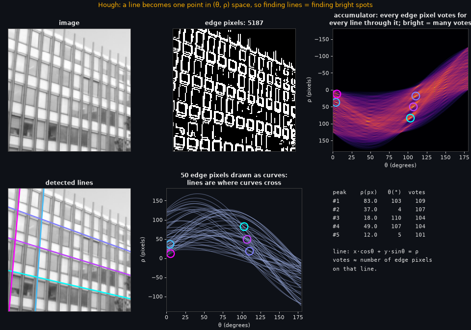
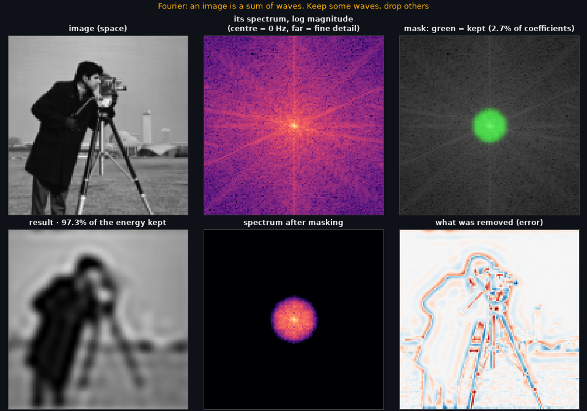
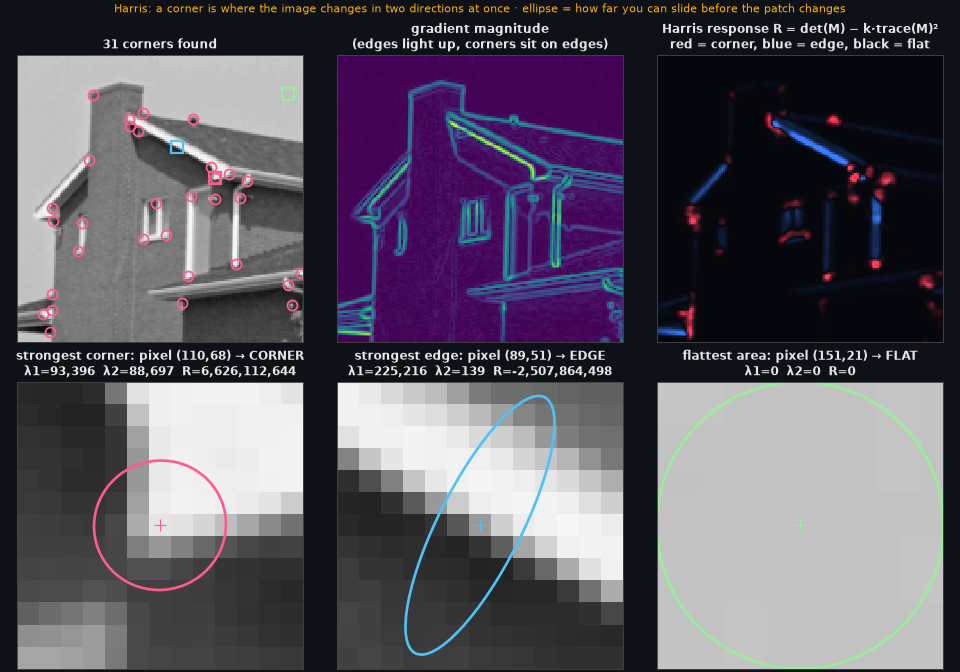
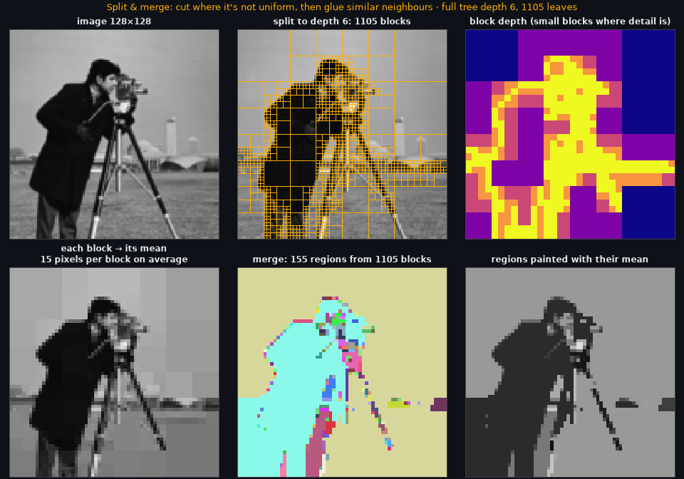

# Image processing from scratch


**Classical computer vision, written from first principles with numpy only, plus an interactive demo that runs entirely in your browser: your images are never uploaded.**
Histograms, convolution, the Fourier transform, Harris corners, Hough lines, quadtree segmentation and Huffman coding, each one a small tested function you can read in a few minutes.

**Live demo: https://cv.shmod.me** (first load downloads the Python runtime; later visits are cached).



## Why I built it

I wanted to understand these algorithms well enough to write them without OpenCV. The ten notebooks in `notebooks/` are where I learned them. Then I pulled the working code into a small package, `cvlab/`, wrote tests against known results (scipy for convolution, the FFT for the DFT), and put a Gradio app on top so that someone can *see* each algorithm work instead of reading about it.

The one design constraint was privacy. A normal Gradio app sends your image to a Python server. This one is compiled to WebAssembly (Gradio-Lite on Pyodide), so Python runs inside your own tab and there is no server that ever sees a pixel.

## What you can play with

| Tab | What you see | The idea in one line |
|---|---|---|
| Histograms | image, histogram, cumulative curve, the transfer function | equalising uses the cumulative histogram as the mapping |
| Convolution | the window, the kernel, the products and their sum for a pixel you choose | an output pixel is a weighted sum of its neighbours |
| Noise and filters | clean, noisy, filtered, with PSNR | the median outvotes outliers, the mean smears them |
| Fourier | the spectrum, the mask you apply, what was removed | an image is a sum of waves; erase some and look |
| Harris | response map, plus the structure-tensor ellipse for a corner, an edge and a flat patch | a corner changes in two directions at once |
| Hough | the accumulator, the sinusoid of each edge pixel, the detected lines | a line is a single point in (θ, ρ) space |
| Quadtree | split blocks, depth map, merged regions | cut where the image is not uniform, then glue similar neighbours |
| Huffman | the code tree, entropy against average code length | frequent symbols get short codes |

| | | |
|---|---|---|
|  |  |  |

## A worked example: equalising

The cumulative histogram *is* the mapping: a level `v` goes to `round((cdf(v) − cdf_min) / (N − cdf_min) · 255)`. Because it comes from probability, the result is only approximately flat for discrete images, which `tests/test_cvlab.py::test_equalise_flattens_cumulative_histogram` checks. The Histograms tab draws that curve on top of your own image.

## Run it

```bash
pip install -r requirements-dev.txt
python -m pytest -q            # 17 tests
python scripts/build_demo.py   # builds site/ (needs node + npm once, to fetch Gradio-Lite)
python -m http.server -d site 8000
```

Then open http://localhost:8000. The first load downloads the Python runtime (tens of MB, cached afterwards); every image you drop in stays in the page.

To rebuild the figures above: `python scripts/make_figures.py`.

## How it is laid out

```
cvlab/         the algorithms, numpy only (histogram, filters, fourier, harris, hough, quadtree, huffman)
tests/         pytest: scipy and the FFT as references, plus properties (prefix-free, lossless, ...)
demo/          the Gradio app (app.py) and the figure builders (figures.py)
scripts/       build_demo.py (static site), make_figures.py (README images)
notebooks/     the ten lab notebooks the code came from, named by topic
Dockerfile     builds site/ and serves it with nginx
```

## What is and isn't there

- The DFT is the plain matrix definition, O(N³), so the Fourier tab downsamples to 128 px. The FFT is used only in the tests, as a reference.
- Hough finds straight lines only (no circles yet), and the quadtree merge is order-dependent: merging chains through similar neighbours, which you can see in the demo when you raise the tolerance.
- There is no timing benchmark in the repo yet, so I make no speed claims.
- The page fetches code, never data: the Python runtime from jsdelivr and some wheels from PyPI, all plain GET requests. I checked with a headless browser that uploading an image sends no request with a body, and I switched Gradio's telemetry off. Self-hosting the runtime would remove even those code downloads.
- Gradio-Lite pins an old Pyodide, so the build patches one line of its worker to pre-install a dependency set that still resolves (`scripts/build_demo.py` explains why).

## Learn the theory

Each algorithm has a long-form lesson in my notes (an eight-part series, "Image Processing From Scratch"). The demo is the lab, the series is the course.

## License

MIT
